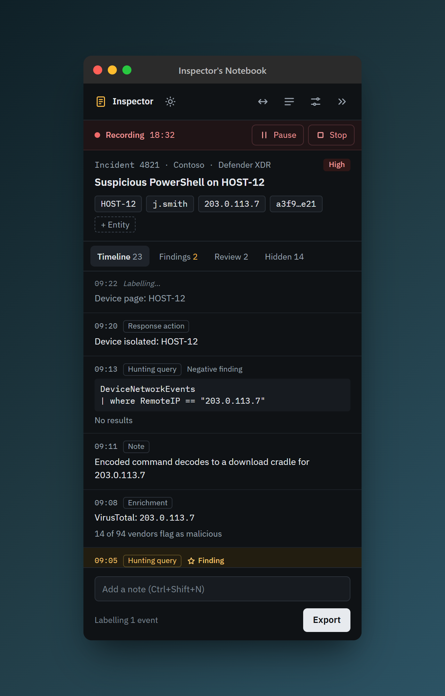

<div align="center">


# Inspector's Notebook

A local flight recorder for SOC investigations.

</div>

Inspector's Notebook records what you do in security consoles during an investigation and will hand back a timestamped timeline ready to paste into a ticket. It is built for a single analyst on their own Windows machine: a listener extension in Chrome, Edge or Firefox feeds a desktop panel docked to the edge of your screen. Everything stays on your machine.

<p align="center">
  
</p>

> **Status:** early development. The docked panel, the browser connection, Defender XDR and Sentinel query capture, and recording cases work today. The timeline view, notes and export follow.

## Features

**Available now**

- **A panel that stays out of the way.** Docks to the right or left screen edge and other windows make room for it. Collapse it to a 64 px rail, switch sides in one click, drag to resize, and pick a dark or light theme.
- **Always listening, never recording without you.** The extension watches Defender XDR and Azure portal tabs, but nothing is captured unless the app is open.
- **One click to start.** Open Inspector from the browser's toolbar popup and the app starts and connects.
- **Queries captured as you run them.** Advanced hunting in Defender XDR and Logs in Sentinel: the exact KQL, the row count, the columns, and the error if it fails. Entities such as IPs, hashes and files are picked out of the results.
- **Cases that sort themselves.** Start a case, add the hosts, users and IPs you care about, and every capture is kept, sent for review or hidden: anything that mentions a case entity is always kept, while duplicates, list pages, events from another tenant and anything captured while you were away are set aside. Nothing is deleted; hidden events can be restored.
- **Per-tab pause.** Stop capture in any console tab from the popup.
- **Local only.** The browser and the app talk over a pipe only your Windows account can open. Nothing listens on a network port.

**Planned**

- Timeline view with findings highlighted, notes and one-click keep or hide.
- Export to plain text, Markdown or HTML, with key findings first.
- A rolling cache of your last five cases.
- A local decision model that labels events and suggests when to start a case.

## Quick start

You need Windows 10 or 11, [uv](https://docs.astral.sh/uv/) and [Node.js](https://nodejs.org/). There is no installer yet, so install from source. From the repository folder:

```bash
uv sync
uv run inspectors-notebook-register install
cd extension && npm install
```

The second command lets Chrome, Edge and Firefox start the app's relay. It writes to your user registry only, so no admin rights are needed.

Then load the extension from `extension/src`:

- **Chrome or Edge:** open `chrome://extensions` or `edge://extensions`, turn on Developer mode, choose **Load unpacked** and pick `extension/src`.
- **Firefox:** open `about:debugging#/runtime/this-firefox`, choose **Load Temporary Add-on** and pick `extension/src/manifest.json`. Firefox removes temporary add-ons when it restarts.

Restart any browser that was already open.

## Usage

Start the panel:

```bash
uv run inspectors-notebook
```

or click **Open Inspector** in the extension's toolbar popup. The panel docks to the screen edge and its status strip shows what the extension can see, for example `Extension listening in 2 tabs`. Close the panel from the taskbar or with Alt+F4.

To remove the browser registration:

```bash
uv run inspectors-notebook-register uninstall
```

The registration points at this folder's `.venv`, so run `install` again if you move the repository.

## Documentation

- [Window behaviour checklist](tests/manual/S1-window-checklist.md): docking, multiple monitors, mixed scaling and sleep.
- [Relay and extension checklist](tests/manual/S2-relay-checklist.md): the browser connection end to end.
- [Lab capture guide](tests/manual/S3-lab-capture-guide.md): what to capture in the lab to finish the console parsers.
- [Cases checklist](tests/manual/S4-case-checklist.md): starting, pausing and stopping cases in the real app.
- [Decisions](docs/decisions.md): where the build departs from the original requirements, and why.

## For developers

The project is built in stages, each finished with passing tests before the next starts. Stages 1 (panel) and 2 (relay and extension) are complete. Stage 3 (console parsers) captures Defender XDR and Sentinel queries; reading incident IDs from URLs needs a lab incident to capture. Stage 4 (cases and rules) is built. Decisions that changed the original requirements are in [docs/decisions.md](docs/decisions.md).

| Path | What it holds |
| --- | --- |
| `src/inspectors_notebook/` | Companion app: panel, AppBar docking, pipe, relay, browser registration |
| `extension/src/` | Listener extension, one Manifest V3 codebase for all three browsers |
| `extension/src/parsers/` | One versioned module per console |
| `tests/` | Python unit and integration tests, plus manual checklists |
| `extension/tests/` | Browser round-trip tests |

Run the tests:

```bash
uv run pytest                  # unit and pipe tests
uv run pytest -m desktop       # real docking and window capture; uses the desktop while it runs
cd extension
npm run test:unit              # parser framework, request hook, entities
npm test                       # Chrome and Edge
npm run test:firefox           # Firefox
npm run lint                   # web-ext lint
```

The browser tests need the relay registered and the app closed. They serve console pages locally, so they never reach the real consoles.

Two rules apply to every change: all inference runs locally and captured data never leaves the machine, and test fixtures come from a purple team lab, never from real client data.

## Licence

Not chosen yet.
